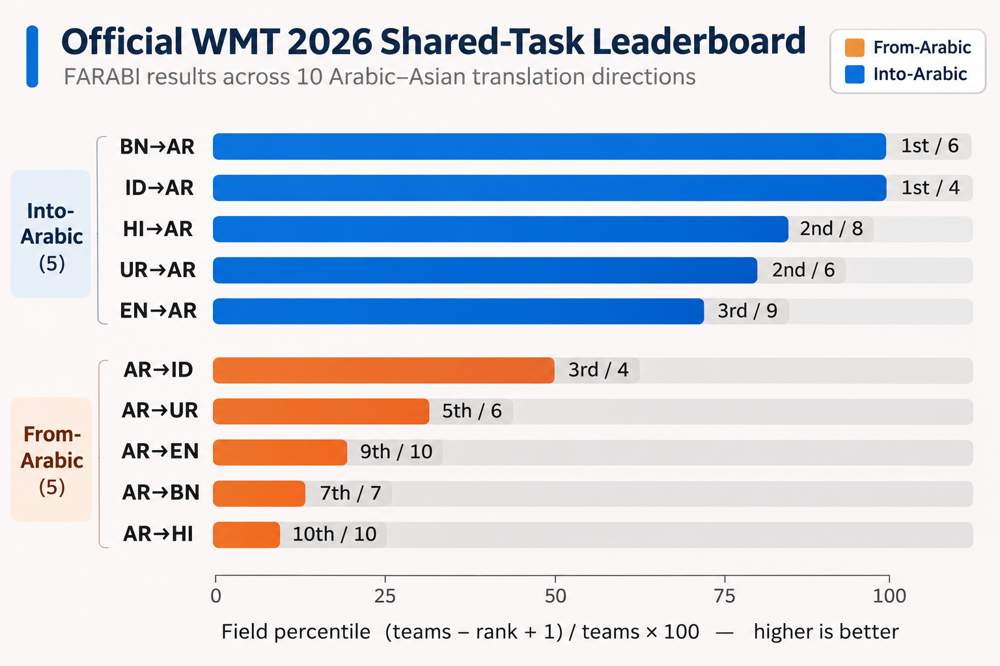
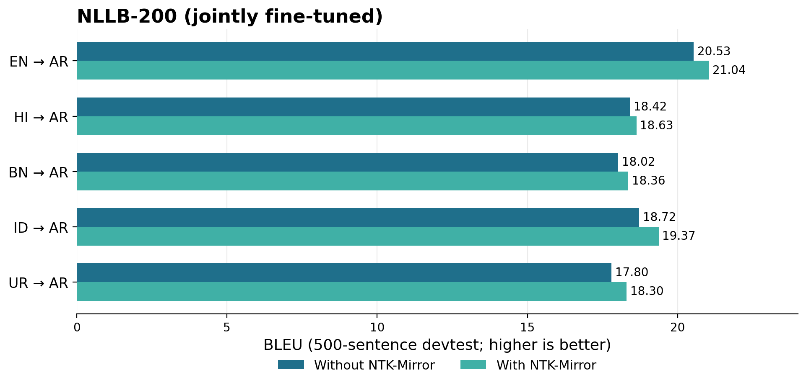

On **29 October 2026**, we presented our paper, *“FARABI at WMT 2026: Post-Hoc Channel Controllers for Low-Resource Arabic–Asian Machine Translation,”* at **EMNLP 2026 in Budapest**. See [here](https://aclanthology.org/2026.wmt-main.166/) for the paper in the WMT 2026 proceedings.

Our work was part of the **WMT 2026 Low-Resource Arabic–Asian Machine Translation shared task**, covering ten translation directions between Arabic and five languages: English, Hindi, Bengali, Indonesian, and Urdu. With approximately 20,000 parallel training sentences per language pair, the task provided an opportunity to investigate how multilingual translation models can be adapted effectively in low-resource settings.

## Our FARABI System

We developed FARABI using two multilingual backbone models: **NLLB-200 (3.3B)** and **Qwen2.5-7B-Instruct**, combined with different adaptation strategies.

For **translation into Arabic**, we jointly fine-tuned NLLB-200 on all five source languages. This allowed the model to benefit from shared multilingual representations while using a single fine-tuned backbone. We then applied **NTK-Mirror**, a lightweight post-hoc controller, separately for each translation direction.

For **translation from Arabic**, we explored Qwen2.5-7B-Instruct with QLoRA, together with NTK-Mirror controllers. We also investigated alternative configurations, including zero-shot NLLB-200 and retrieval-augmented translation.

The central research question was whether we could improve translation quality **after backbone adaptation, without further updating its weights**.

NTK-Mirror addresses this by selecting **5,000 layer–channel pairs** based on their activation magnitudes and learning a small scaling parameter for each. These parameters adjust internal activations while leaving the backbone frozen, making the controller substantially smaller than conventional fine-tuning adapters.

## Official Shared-Task Results

Our FARABI primary submission ranked among the **top three teams in all five into-Arabic translation directions**, achieving **first place for Bengali-to-Arabic and Indonesian-to-Arabic**, second place for Hindi-to-Arabic and Urdu-to-Arabic, and third place for English-to-Arabic.

*Official WMT 2026 challenge-test rankings and BLEU scores for FARABI's into-Arabic submissions.*

## Evaluating NTK-Mirror

To investigate the contribution of NTK-Mirror, we compared our jointly fine-tuned NLLB-200 backbone **with and without the controller**.

NTK-Mirror improved BLEU in all five into-Arabic directions, with gains ranging from **+0.21 to +0.65 BLEU**. Four of these improvements were statistically significant according to paired-bootstrap testing.

*BLEU comparison on the 500-sentence devtest set. These results are separate from the official challenge-test leaderboard scores.*

The experiments also revealed an important limitation: **the effectiveness of NTK-Mirror depends on the underlying backbone and adaptation strategy**. While the controller consistently improved the fine-tuned NLLB-200 system for translation into Arabic, its benefits were more variable with other configurations.

Our post-submission analysis further showed that **backbone selection and direction-specific fine-tuning were especially important for translation from Arabic**. Jointly fine-tuning NLLB-200 substantially narrowed the performance gap in those directions.

Overall, our findings suggest that lightweight post-hoc controllers can provide useful improvements with minimal trainable parameters, but they work best as a refinement of an already well-adapted translation model rather than a replacement for fine-tuning.

[NTK-Mirror Code](https://github.com/leochlon/ntkmirror) · [NLLB-200 Checkpoint](https://huggingface.co/Farizeh/nllb-eng-arabic-wmt26)
