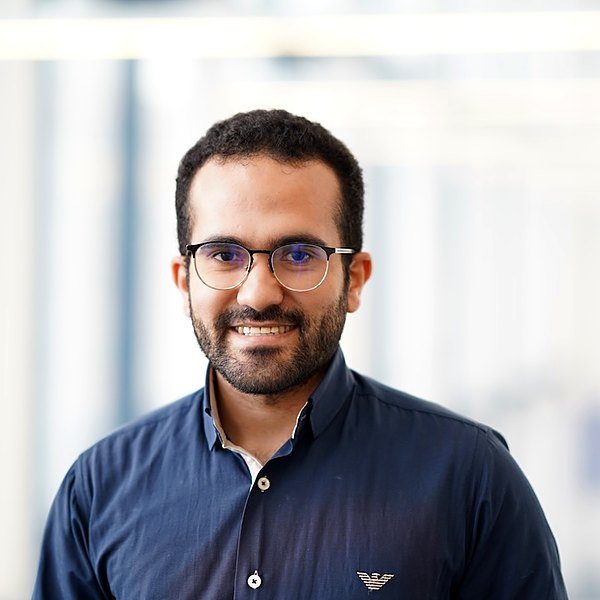

{: style="float: right; margin: 0 0 1em 1em; max-width: 250px; border-radius: 4px;"}

## About me

I am a **Data Scientist** at **Fraunhofer IAIS** and a PhD researcher at the **Applied Machine Learning Lab (AML Lab)** at the **University of Bonn**. My work sits where research meets industry: alongside my PhD, I work on **industrial machine learning projects**, taking models from an idea to systems that run reliably on real-world data.

My research centres on **low-resource languages, and Arabic in particular**. Arabic is one of the five most spoken languages in the world, yet it remains underserved by today's language models: its many dialects differ sharply from Modern Standard Arabic, diacritics are usually left out of written text, and its script is still hard to read reliably from scanned and photographed documents. I build the datasets, models and evaluations needed to close these gaps.

A recurring theme in my work is **making training work under real constraints**. I optimise how models are trained for the amount and quality of data available, diagnose and fix training problems, and use **knowledge distillation** to turn large models into compact ones that are cheaper to deploy. I also design **fine-tuning pipelines** that adapt foundation models to a specific problem, from data preparation to evaluation.

More recently, I have been building **agentic systems** and researching how LLM-based agents plan, use tools and solve multi-step tasks, while continuing to work on **OCR and multimodal models** that bring text and vision together.


  Optional: add a paragraph on your background here (degrees, previous
  positions), as on the other team pages.


## Research Interests

- **Low-Resource & Arabic NLP:** Dialect identification, bridging Modern Standard Arabic and dialectal Arabic, and automatic diacritization (Tashkeel) for downstream Arabic NLP tasks.

- **OCR & Multimodal Document Understanding:** Evaluating and improving how OCR systems and multimodal models read and understand Arabic documents.

- **Training Optimisation & Data Efficiency:** Adapting training to the size and quality of the available data, and diagnosing and solving the problems that make training unstable or inefficient.

- **Knowledge Distillation & Efficient Models:** Transferring the capabilities of large models into smaller, faster ones that are practical to deploy.

- **Fine-Tuning Systems:** Building end-to-end pipelines that adapt foundation models to new tasks and domains.

- **Agentic Systems:** Designing LLM-based agents and studying how they reason, use tools and coordinate on complex tasks.

- **Noise-Robust Learning:** Using abstention to learn reliably from noisy annotations, with applications in medical imaging.

## Selected recent work


  Google Scholar: replace YOUR_ID with your profile ID and remove the comment
  tags around the line below.

  The one-paragraph summaries below are drafted from the paper titles only.
  Rewrite them in your own words, e.g. with the main finding of each paper.


[**Google Scholar**](https://scholar.google.com/citations?user=YOUR_ID)


### Knowing When to Abstain

**Generalizing Abstention for Noise-Robust Learning in Medical Image Segmentation**

*MIDL 2026*

We extend abstention, letting a model set aside samples it cannot learn from reliably, to medical image segmentation, so that training stays robust when the annotations are noisy.

[\[Paper\]](https://proceedings.mlr.press/v315/moustafa26a.html)

### Arabic OCR in the Age of Multimodal Models

**A Comprehensive Comparative Evaluation**

*IEEE BigData 2025*

We compare OCR systems and multimodal models on reading Arabic text, to see where each approach works well and where Arabic script still causes problems.

[\[Paper\]](https://doi.org/10.1109/BIGDATA66926.2025.11402448)

### ArDia

**Improving Arabic Dialectal Language Classification Using a Novel Dataset**

*ICWSM 2025*

We introduce ArDia, a new dataset for classifying Arabic dialects, and use it to improve how well models tell the dialects apart.

[\[Paper\]](https://doi.org/10.1609/ICWSM.V19I1.35944)

## Contact Details

If you want to get in contact, write an Email to hossam.elsafty[at]iais.fraunhofer.de. For thesis or course enquiries, you can also reach the lab at amllab[at]bit.uni-bonn.de.
